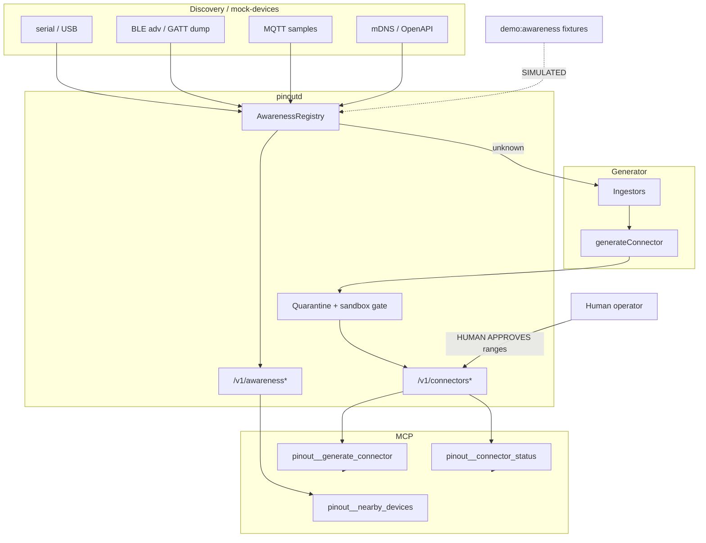

# Device awareness and automatic connectors

**Status: SIMULATED software path.** Pinout has never run on real hardware in this repository. The end-to-end demo (`npm run demo:awareness`) uses fixtures and, until PR1–PR4 merge, a labeled local stub of the daemon/MCP surface. Nothing here is `HARDWARE_VERIFIED`. Evidence vocabulary is the canonical [`SupportLevel`](evidence-levels.md) from `@pinout/core`.

## Product story

```text
plug in anything
        │
        ▼
   awareness (seen / identified)
        │
        ├── known module? ──► enroll / use existing module
        │
        └── unknown ──► generate connector (quarantined, read-only)
                              │
                              ▼
                    HUMAN APPROVES physical-output ranges
                              │
                              ▼
                    install (still disarmed)
                              │
                              ▼
                    AI agent uses it through MCP
```

## Architecture



| Layer | Responsibility |
| --- | --- |
| Awareness | Observe endpoints; classify `SEEN` / `IDENTIFIED` / …; never auto-arm |
| Generator | Ingest hello / GATT / MQTT / mDNS evidence → candidate connector |
| Quarantine | Sandboxed conformance; **read-only** until human approval |
| Approve | Explicit physical-output capability + numeric ranges |
| MCP | Agent tools for nearby devices, generate, status, list — no silent approve |

## Status vocabulary

### Awareness states

| State | Meaning |
| --- | --- |
| `SEEN` | Endpoint observed; identity incomplete or unmatched |
| `IDENTIFIED` | Heuristic / hello matched a known `moduleId` |
| `PENDING_ENROLL` | Human/agent requested enroll; not yet online |
| `ONLINE` | Enrolled / installed connector available to runtime |
| `STALE` / `OFFLINE` | Last-seen aged out or link lost |

### Connector lifecycle

| Status | Meaning |
| --- | --- |
| `CANDIDATE` | Generated but failed sandbox / typecheck |
| `QUARANTINED` | Passed sandbox; **read-only**; physical output blocked |
| `APPROVED` | Human unlocked listed capabilities + ranges |
| `INSTALLED` | Registered for runtime/MCP use; **still disarmed** |
| `REJECTED` | Operator rejected the candidate |

### Evidence (`SupportLevel`)

Canonical ladder from `@pinout/core` (PR0):

`UNKNOWN` → `SIMULATED` → `COMPILE_TESTED` → `HARDWARE_VERIFIED`

Rules:

1. Generated connectors **never** exceed `COMPILE_TESTED` without a dated `hardware/records/` entry (`applyEvidenceRules` / `capSupportLevel`).
2. This repository currently has **no** awareness/connector `HARDWARE_VERIFIED` claim.
3. Simulator and fixture demos must stay labeled `SIMULATED`.

Full mapping tables and honesty rules: [evidence-levels.md](evidence-levels.md). Also [hardware-support.md](hardware-support.md).

## Threat / safety model

| Risk | Mitigation |
| --- | --- |
| Agent invents actuator ranges | Physical-output caps stay `SAFETY_APPROVAL_REQUIRED` until **HUMAN APPROVES** |
| Auto-arm on install | Install leaves `armed: false`; arm remains an explicit governed action |
| Spoofed BLE name / MQTT topic | Awareness confidence is heuristic; evidence stays ≤ `COMPILE_TESTED` |
| Generated code as trusted driver | Quarantine + sandbox conformance; human review before install |
| Out-of-range after approve | `POLICY_CONSTRAINT_VIOLATION` on approved numeric ranges |
| Remote exposure | Daemon loopback-by-default; Bearer token for mutating routes |
| Demo mistaken for HIL | Fixtures + `SIMULATED` labels on HTTP (`x-pinout-demo`), transcript, docs |

This layer does **not** replace hardware E-stop, electrical safe-state commissioning, or dated HIL records. See [safety-model.md](safety-model.md) and [generator-safety.md](generator-safety.md).

## How to try it (no hardware)

```bash
npm install
npm run build
npm run demo:awareness
```

What you should see:

1. Known mock ESP32 → `IDENTIFIED`
2. Unknown BLE lamp → `SEEN`
3. Connector → `QUARANTINED` (read-only `lamp.status` OK)
4. Physical invoke → `SAFETY_APPROVAL_REQUIRED`
5. Banner **`>>> HUMAN APPROVES <<<`** with ranges
6. Out-of-range → `POLICY_CONSTRAINT_VIOLATION`; in-range → OK (`simulated: true`)
7. [`examples/awareness-connector-demo/transcript.md`](../examples/awareness-connector-demo/transcript.md) updated (SIMULATED)

Headless CI:

```bash
npm test -- examples/awareness-connector-demo/test/e2e.test.ts
```

Fixtures live under `examples/awareness-connector-demo/fixtures/` (mock-devices, GATT dump, MQTT samples).

### After PR1–PR4 merge

```bash
# once pinoutd supports --mock-devices and /v1/awareness + /v1/connectors:
pinoutd --discover --mock-devices examples/awareness-connector-demo/fixtures/mock-devices.json
export PINOUT_DAEMON_URL=http://127.0.0.1:8787
export PINOUT_TOKEN=...
export PINOUT_AWARENESS_DEMO_USE_UPSTREAM=1
npm run demo:awareness
```

Until then the demo prints an explicit **stubbed** list in its summary.

Related drafts from parallel PRs (link once merged): `docs/awareness.md` (PR1), `docs/mcp-awareness.md` (PR2). This overview stays the product-story entry point.

## HTTP / MCP contracts (for implementers)

**Awareness**

- `GET /v1/awareness` → `{ devices: AwarenessRecord[] }`
- `GET /v1/awareness/:id`
- `GET /v1/awareness/events` (SSE)
- `POST /v1/awareness/:id/enroll` (pending request only)

**Connectors**

- `POST /v1/connectors/generate` `{ awarenessId }`
- `GET /v1/connectors` / `GET /v1/connectors/:id`
- `POST /v1/connectors/:id/approve` `{ capabilities, ranges }`
- `POST /v1/connectors/:id/install` | `reject`

**MCP tools:** `pinout__nearby_devices`, `pinout__awareness_events`, `pinout__describe_nearby`, `pinout__request_enroll`, `pinout__generate_connector`, `pinout__connector_status`, `pinout__list_connectors`

**Approve body example**

```json
{
  "capabilities": ["lamp.setBrightness", "lamp.status"],
  "ranges": {
    "lamp.setBrightness": {
      "percent": { "min": 0, "max": 80 }
    }
  }
}
```

## What remains for HIL

Software e2e does **not** verify radios, brokers, or GPIO. Add physical checks only under dated `hardware/records/` and the HIL campaign docs — see the checklist item in [`scripts/hil/esp32-classic.md`](../scripts/hil/esp32-classic.md). **Do not mark awareness/connector paths verified** until that campaign records operator-observed results.
